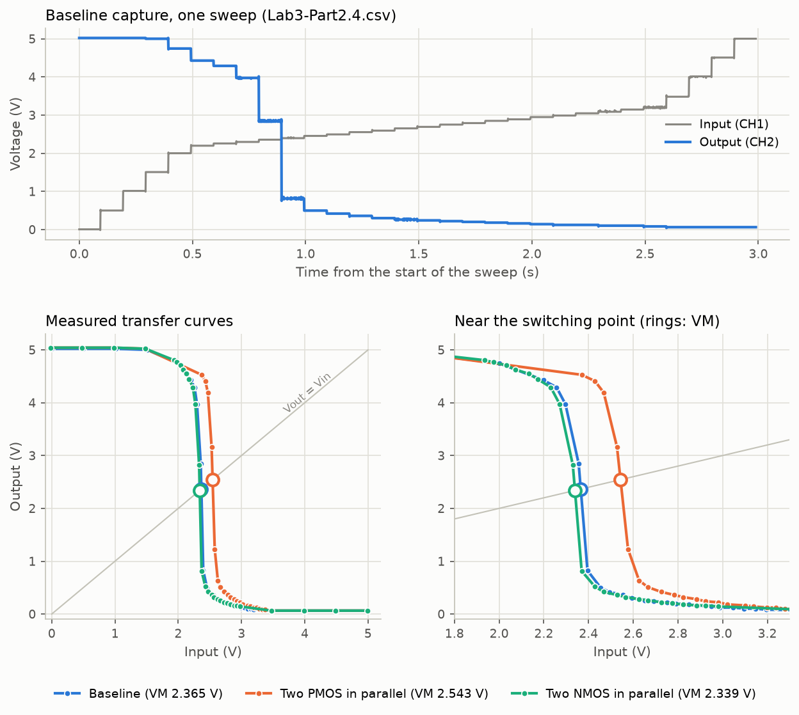
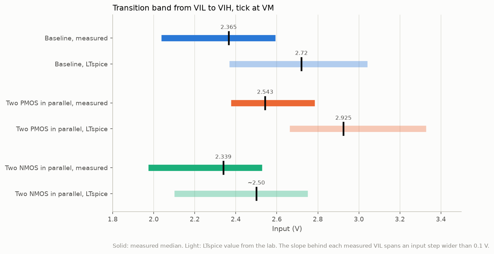

# CMOS inverter characterization

I built three CMOS inverters from CD4007 transistors and compared their measured transfer curves with LTspice.



It started as an EEC 111 lab at UC Davis in Spring 2026. The question was how transistor strength moves an inverter's switching point and noise margins. After the course I went back to the raw scope captures and wrote a Python script that gets the numbers straight from them.

## What I did

The first inverter is a plain one with one NMOS and one PMOS. In the second I put two PMOS in parallel to make the pull-up stronger. In the third I put two NMOS in parallel to make the pull-down stronger. All three ran on a breadboard from 5 V.

I measured them with an ADALM2000 and Scopy. Its signal generator stepped the input from 0 to 5 V while its scope recorded the input and the output. I used 0.5 V steps far from the switching point and 50 mV steps near it, so the points are closest together around the switching point. I also simulated the same circuits in LTspice with the course's CD4007 model. The raw captures are in [data/](data/).

The script is `analyze.py`. It finds the switching point, where the output equals the input, and the noise margins on each full sweep. Then it draws the plots. It has 34 tests, and most of them run on synthetic curves where the right answer is known. GitHub Actions runs the tests and the analysis on every push.

## What I found

Two PMOS in parallel moved the switching point up by about 180 mV. LTspice predicted just over 200 mV, so the model got the direction and roughly the size right. The stronger pull-up also cut the high noise margin by about 0.17 V.

All three measured switching points sit below LTspice. On the plain inverter the gap is about 0.35 V. A DC sweep doesn't depend on breadboard capacitance, so I read this as a difference between the LTspice model and the real CD4007 parts.



Each bar covers the inputs where the output falls faster than the input rises, from VIL to VIH. The tick marks the switching point. Solid bars are measured and light ones are LTspice.

## Problems I ran into

The scope only resolves about 20 mV. Near the switching point the input moves 50 mV at a time, so a slope taken sample by sample is too noisy. The script splits the input into flat steps first and takes the median of each one. Each capture also starts and stops partway through the staircase, so it keeps only the sweeps that cover the full range.

On the low side of each curve the input steps were still wide. The slope that sets VIL reaches across a step of 0.45 V or more. So VIL and the low noise margin are only as fine as that step, and the tables mark them with a star. The switching point and VIH come from the 50 mV steps.

I can't read much into the two-NMOS result. Its switching point came out only 26 mV below the plain inverter's. LTspice predicted a drop of about 220 mV. But the PMOS and NMOS captures both read the 0 V input step 26 mV lower than the baseline capture did, so the shift is no bigger than the offset between captures. The PMOS shift is about seven times that offset, so it still stands.

## Run it

```
pip install -r requirements.txt
python analyze.py data/*.csv
pytest
```

The script prints the numbers for each sweep and writes `results/summary.md` and both plots. With `--readme README.md` it also refreshes the tables below, and a test checks that they still match the data. More detail on the setup and the method is in [docs/details.md](docs/details.md).

<details>
<summary>Full results tables</summary>

<!-- results:start (generated by analyze.py) -->
All values are in volts. Each measured value is the median over the full sweeps in its capture.

| Circuit | Source | VOH | VOL | VM | VIL | VIH | NML | NMH |
|---|---|---:|---:|---:|---:|---:|---:|---:|
| Baseline | Measured | 5.021 | 0.063 | 2.365 | 2.036\* | 2.593 | 1.974\* | 2.428 |
| Baseline | LTspice | 5.00 | 0.00 | 2.72 | 2.369 | 3.041 | 2.369 | 1.959 |
| Two PMOS in parallel | Measured | 5.042 | 0.064 | 2.543 | 2.377\* | 2.784 | 2.313\* | 2.258 |
| Two PMOS in parallel | LTspice | 5.00 | 0.00 | 2.925 | 2.663 | 3.328 | 2.663 | 1.672 |
| Two NMOS in parallel | Measured | 5.042 | 0.064 | 2.339 | 1.974\* | 2.527 | 1.910\* | 2.515 |
| Two NMOS in parallel | LTspice | 5.00 | 0.00 | ~2.50 | ~2.10 | ~2.75 | ~2.10 | ~2.25 |

\* The slope here spans an input step of 0.45 to 0.89 V, so this value is only as fine as that step.

Switching point shift from the baseline:

| Circuit | Measured VM (V) | Measured shift (mV) | LTspice VM (V) | LTspice shift (mV) |
|---|---:|---:|---:|---:|
| Baseline | 2.365 |  | 2.72 |  |
| Two PMOS in parallel | 2.543 | +178 | 2.925 | +205 |
| Two NMOS in parallel | 2.339 | -26 | ~2.50 | ~-220 |

Capture checks:

| File | Full sweeps | Steps per sweep | Input at the 0 V step (V) | VM spread over sweeps (mV) |
|---|---:|---:|---:|---:|
| Lab3-Part2.4.csv | 2 | 30 | 0.006 | 0.1 |
| Lab3-Part2.5-strongerPMOS.csv | 2 | 29 | -0.020 | 6.2 |
| Lab3-Part2.5-strongerNMOS.csv | 4 | 30 | -0.020 | 0.3 |
<!-- results:end -->

</details>

## Credits

The lab procedure and the driver and load test fixture come from the EEC 111 course at UC Davis. The CD4007 LTspice model and the device values used in the lab also came from the course. I built and measured the circuits and ran the LTspice simulations. I added the analysis script and its tests after the course.
